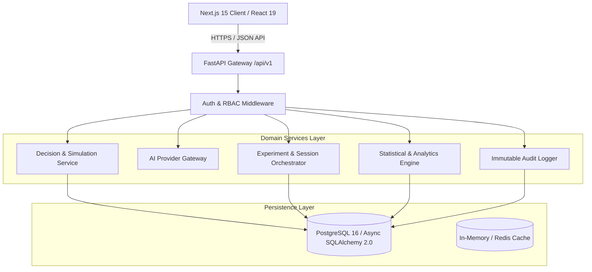

# SENTRA — System Architecture

## 1. System Philosophy

SENTRA is engineered as an enterprise-grade decision intelligence platform and research laboratory. The platform prioritizes:
1. **Mathematical Ground Truth over Generative Approximations**: LLMs assist and explain; deterministic numerical models score and validate outcomes.
2. **Epistemic Transparency**: AI recommendations are decomposed into empirical evidence, explicit assumptions, known limitations, and uncertainty bounds.
3. **Research Rigor**: Double-blind experimental protocols, reproducible server-side randomization, millisecond-precision reaction timing, and transparent statistical tests.
4. **Tenant Isolation & Security**: Strict role-based access control (RBAC) and row-level tenant boundaries.



## 2. Component Boundaries

### Frontend (`frontend/`)
- **Next.js 15 App Router**: Modern server-rendered and client-hydrated layout structure.
- **State Management**: Lightweight Zustand stores for local experimental session state and TanStack Query for server state caching.
- **Design System (SEDS)**: Handcrafted Tailwind CSS tokens ensuring warm ivory canvas, deep graphite typography, and restrained semantic cognition markers.
- **Telemetry Module**: `performance.now()` precision measurement synchronously captured on user decision events.

### Backend (`backend/`)
- **FastAPI Core**: Asynchronous ASGI framework running under Python 3.12.
- **SQLAlchemy 2.0 Async Engine**: Clean ORM models supporting PostgreSQL in production and SQLite for zero-friction local development and testing.
- **Pydantic v2**: Strict bidirectional request/response schemas with field validation and OpenAPI schema export.
- **AI Gateway**: Abstract provider interface (`AIProviderBase`) decoupling business logic from OpenAI, Anthropic, or mock research stubs.
- **Statistical Engine**: SciPy / Statsmodels integration delivering real-time hypothesis testing (Welch's t-test, Mann-Whitney U, Cohen's d) and calibration curves.

## 3. Tenant & Data Isolation
All relational entities carry an `organization_id` foreign key. Database queries are scoped to the authenticated user's active tenant via dependency injection:
```python
async def get_current_tenant_session(
    current_user: User = Depends(get_current_user),
    db: AsyncSession = Depends(get_db)
) -> TenantContext: ...
```
Cross-organization data access without explicit administrative permission raises an HTTP 403 Forbidden exception.
