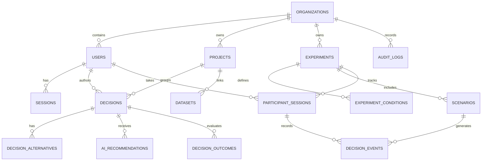

# SENTRA — Database Schema & Data Architecture

## Relational Entity-Relationship Diagram

## Schema Definitions

### 1. `organizations`
- `id` (UUID, PK)
- `name` (VARCHAR 255, NOT NULL)
- `slug` (VARCHAR 100, UNIQUE, NOT NULL)
- `tier` (VARCHAR 50, DEFAULT 'enterprise')
- `settings` (JSONB / TEXT)
- `created_at` (TIMESTAMP WITH TIME ZONE)
- `updated_at` (TIMESTAMP WITH TIME ZONE)

### 2. `users`
- `id` (UUID, PK)
- `organization_id` (UUID, FK -> organizations.id, NOT NULL)
- `email` (VARCHAR 255, UNIQUE, NOT NULL)
- `hashed_password` (VARCHAR 255, NOT NULL)
- `full_name` (VARCHAR 255, NOT NULL)
- `role` (VARCHAR 50, DEFAULT 'analyst') — `admin`, `researcher`, `analyst`, `participant`
- `is_active` (BOOLEAN, DEFAULT TRUE)
- `created_at` (TIMESTAMP WITH TIME ZONE)

### 3. `projects`
- `id` (UUID, PK)
- `organization_id` (UUID, FK -> organizations.id, NOT NULL)
- `title` (VARCHAR 255, NOT NULL)
- `description` (TEXT)
- `domain` (VARCHAR 100) — `inventory`, `capital`, `recruitment`, `operations`
- `status` (VARCHAR 50, DEFAULT 'active')
- `created_by` (UUID, FK -> users.id)
- `created_at` (TIMESTAMP WITH TIME ZONE)

### 4. `decisions`
- `id` (UUID, PK)
- `project_id` (UUID, FK -> projects.id, NOT NULL)
- `title` (VARCHAR 255, NOT NULL)
- `problem_statement` (TEXT)
- `constraints` (JSONB / TEXT)
- `selected_alternative_id` (UUID, NULLABLE)
- `human_rationale` (TEXT)
- `status` (VARCHAR 50) — `draft`, `under_review`, `committed`, `audited`
- `created_by` (UUID, FK -> users.id)
- `created_at` (TIMESTAMP WITH TIME ZONE)

### 5. `ai_recommendations`
- `id` (UUID, PK)
- `decision_id` (UUID, FK -> decisions.id, NOT NULL)
- `model_provider` (VARCHAR 100, NOT NULL)
- `model_version` (VARCHAR 100, NOT NULL)
- `prompt_snapshot` (TEXT)
- `recommendation_payload` (JSONB / TEXT, NOT NULL)
- `confidence_score` (FLOAT)
- `uncertainty_bounds` (JSONB / TEXT)
- `evidence_citations` (JSONB / TEXT)
- `assumptions` (JSONB / TEXT)
- `limitations` (JSONB / TEXT)
- `is_deliberately_suboptimal` (BOOLEAN, DEFAULT FALSE)
- `created_at` (TIMESTAMP WITH TIME ZONE)

### 6. `experiments`
- `id` (UUID, PK)
- `organization_id` (UUID, FK -> organizations.id, NOT NULL)
- `title` (VARCHAR 255, NOT NULL)
- `hypothesis` (TEXT)
- `protocol_type` (VARCHAR 100, DEFAULT 'between_subjects')
- `status` (VARCHAR 50, DEFAULT 'draft') — `draft`, `active`, `paused`, `completed`
- `randomization_seed` (INTEGER)
- `created_by` (UUID, FK -> users.id)
- `created_at` (TIMESTAMP WITH TIME ZONE)

### 7. `experiment_conditions`
- `id` (UUID, PK)
- `experiment_id` (UUID, FK -> experiments.id, NOT NULL)
- `code` (VARCHAR 50, NOT NULL) — e.g. `CONDITION_A`, `CONDITION_B`, `CONDITION_C`
- `name` (VARCHAR 255, NOT NULL)
- `description` (TEXT)
- `ai_assistance_mode` (VARCHAR 100) — `none`, `recommendation_only`, `recommendation_with_explanation`

### 8. `scenarios`
- `id` (UUID, PK)
- `experiment_id` (UUID, FK -> experiments.id, NOT NULL)
- `order_index` (INTEGER, NOT NULL)
- `domain` (VARCHAR 100, NOT NULL)
- `scenario_parameters` (JSONB / TEXT, NOT NULL)
- `ground_truth_optimal_value` (FLOAT, NOT NULL)
- `ground_truth_payout_function` (TEXT, NOT NULL)
- `ai_suggested_value` (FLOAT)
- `is_injected_bias` (BOOLEAN, DEFAULT FALSE)
- `bias_magnitude_percentage` (FLOAT, DEFAULT 0.0)

### 9. `participant_sessions`
- `id` (UUID, PK)
- `experiment_id` (UUID, FK -> experiments.id, NOT NULL)
- `condition_id` (UUID, FK -> experiment_conditions.id, NOT NULL)
- `pseudonym_token` (VARCHAR 100, UNIQUE, NOT NULL)
- `started_at` (TIMESTAMP WITH TIME ZONE)
- `completed_at` (TIMESTAMP WITH TIME ZONE, NULLABLE)
- `consent_confirmed` (BOOLEAN, DEFAULT FALSE)
- `user_agent` (VARCHAR 255)

### 10. `decision_events`
- `id` (UUID, PK)
- `session_id` (UUID, FK -> participant_sessions.id, NOT NULL)
- `scenario_id` (UUID, FK -> scenarios.id, NOT NULL)
- `user_action_value` (FLOAT, NOT NULL)
- `reaction_time_ms` (FLOAT, NOT NULL)
- `server_received_at` (TIMESTAMP WITH TIME ZONE)
- `client_timestamp_ms` (FLOAT)
- `subjective_confidence` (FLOAT)
- `ground_truth_deviation` (FLOAT, NOT NULL)
- `economic_loss` (FLOAT, NOT NULL)
- `agreed_with_ai` (BOOLEAN)
- `over_reliance_flag` (BOOLEAN, DEFAULT FALSE)

### 11. `audit_logs`
- `id` (UUID, PK)
- `organization_id` (UUID, FK -> organizations.id, NOT NULL)
- `actor_id` (UUID, FK -> users.id, NULLABLE)
- `action` (VARCHAR 100, NOT NULL)
- `entity_type` (VARCHAR 100, NOT NULL)
- `entity_id` (UUID, NOT NULL)
- `payload` (JSONB / TEXT)
- `ip_address` (VARCHAR 100)
- `created_at` (TIMESTAMP WITH TIME ZONE)
